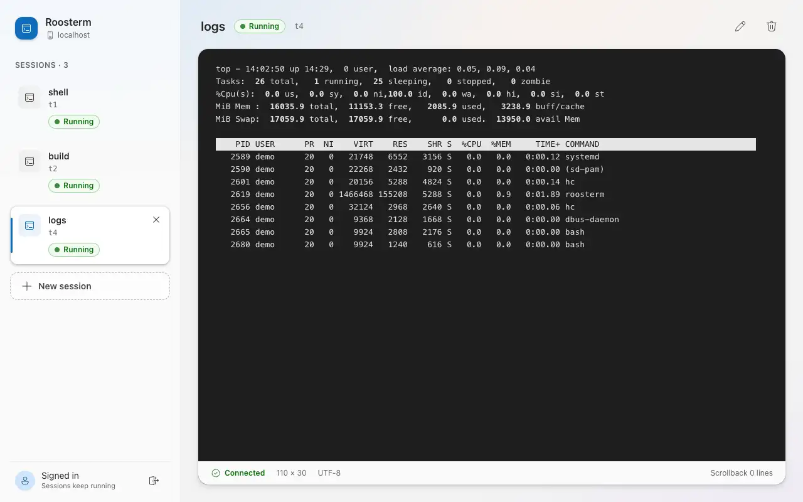
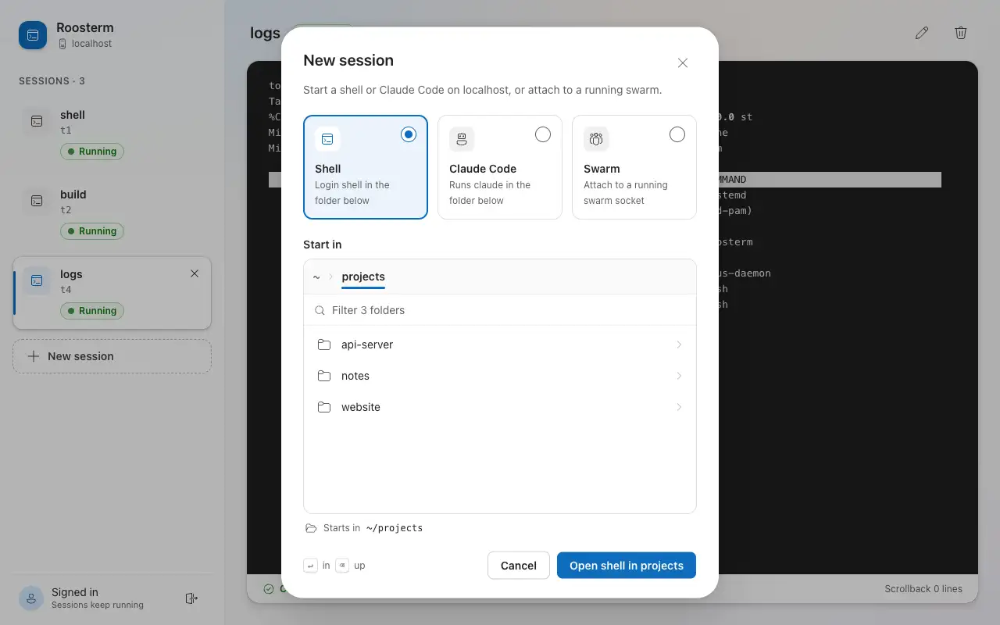
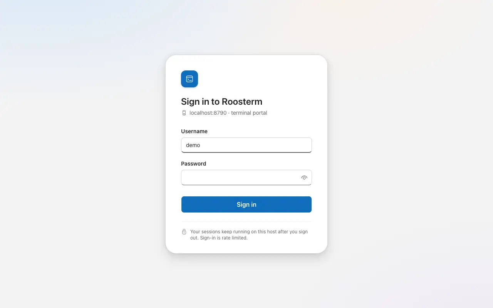
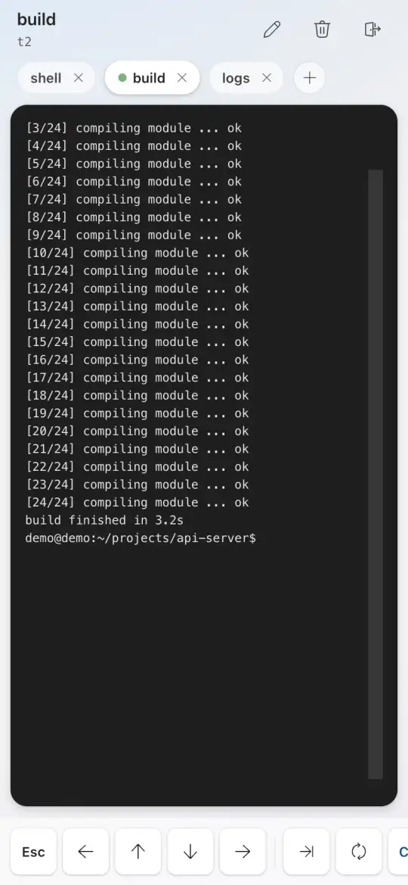
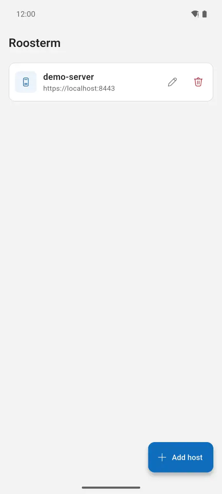
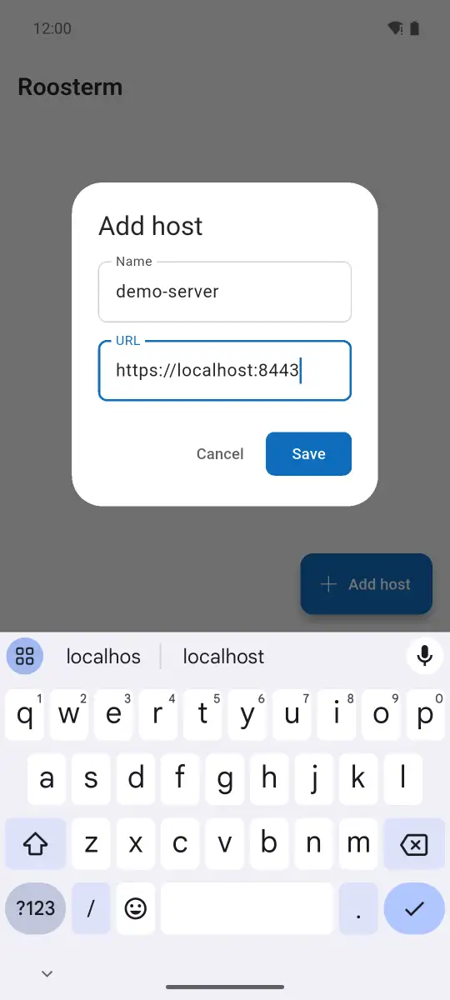
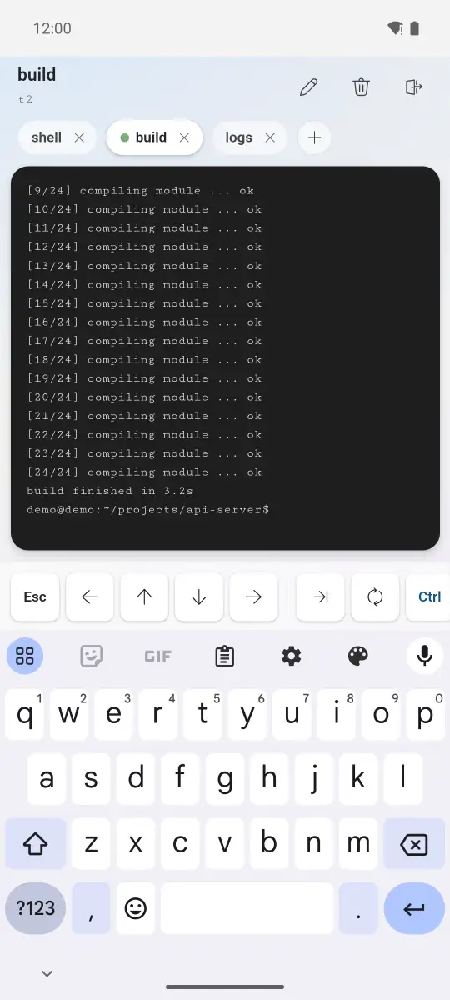

# roosterm

*[繁體中文版本 / Traditional Chinese](README.zh-TW.md)*

roosterm is a self-hosted web terminal. It gives you full terminals (a login shell, Claude Code, any program) in a browser or in an Android app, over HTTPS to your own machine. Closing the browser or restarting roosterm does not stop the running programs.
<!-- evidence: docs/design.md:4; host/cmd/roosterm/main.go:19-22; app/README.md:3 -->

The server runs on your own Mac or Linux machine. Use it from any browser, or from the Android app, which you can download ready-made from [GitHub Releases](https://github.com/jhangyu/roosterm/releases).
<!-- evidence: docs/design.md:7 (no Windows host); gh release view app-v0.0.0 (three APK assets); .github/workflows/release.yml -->

roosterm is a terminal shell only. It never parses Claude Code, and it has no chat UI, push notifications, multiple accounts or Windows host support.
<!-- evidence: docs/design.md:6-9 -->

## Features

This section lists what you get.

- **Programs outlive clients and the server.** Every terminal is owned by herdr-core (`hc`), not by roosterm. Closing the browser, restarting or crashing roosterm, or killing the hc core leaves your programs and their PIDs unchanged. Only `hc server stop` ends them.
  <!-- evidence: docs/design.md:24-25 -->
- **No tab state in roosterm.** A tab is an hc terminal. The hc terminal list is the only tab store (each tab carries the label `roosterm=tab`). Terminals created outside roosterm are invisible to it.
  <!-- evidence: docs/design.md:19; docs/api.md:9 -->
- **Three kinds of new session.** Shell, Claude Code, or attach to a running Claude Code swarm (a `claude-swarm-*` tmux socket).
  <!-- evidence: web/src/workspace/NewSessionDialog.tsx:25,31; docs/api.md:53 -->
- **Mobile-friendly key bar.** Esc, Tab, Shift-Tab and the arrow keys are sent as terminal sequences, honouring application-cursor mode.
  <!-- evidence: web/src/lib/keys.ts:1-18 -->
- **Reconnect without timers.** A reconnect is a fresh attach, and hc repaints the whole screen. The web client reconnects when the browser comes back online or the page returns to the foreground. The server re-dials hc when its socket reappears.
  <!-- evidence: docs/design.md:27-31; host/internal/hc/supervisor.go:26-29 -->
- **Single self-contained binary.** The web client is embedded in the Go binary. No Docker, database or Node is needed at run time.
  <!-- evidence: host/internal/web/static.go:15; docs/design.md:22 -->
- **Folder picker and tab management.** Browse sub-directories under your home to start a tab there. Rename a tab or hide it from the tab strip while its process keeps running.
  <!-- evidence: docs/api.md:86, :79-80 -->

## Contents

- [Screenshots](#screenshots)
- [How it works](#how-it-works)
- [Before you start](#before-you-start)
- [Install](#install)
- [Create your login](#create-your-login)
- [Configuration](#configuration)
- [Start the server](#start-the-server)
- [Put it behind HTTPS](#put-it-behind-https)
- [Use it in a browser](#use-it-in-a-browser)
- [Android app](#android-app)
- [Security notes](#security-notes)
- [Build the Android app](#build-the-android-app)
- [Releases and CI](#releases-and-ci)
- [Development and tests](#development-and-tests)
- [API and design docs](#api-and-design-docs)
- [Project layout](#project-layout)

## Screenshots

This section shows the web client and the Android app. Every screen comes from a demo host.


*Web client on a desktop: the session list and a running terminal.*


*New session: pick Shell, Claude Code or Swarm, and the folder to start in.*


*Sign-in page.*

| Web client on a phone | Android app: hosts | Android app: add host | Android app: terminal |
|---|---|---|---|
|  |  |  |  |

## How it works

This section shows the three pieces and who owns what.

```
browser / Flutter WebView ──HTTPS (your reverse proxy)──▶ roosterm (one Go binary) ──Unix socket, JSON-RPC──▶ herdr-core (hc)
```

- herdr-core (`hc`, version 0.1.21) is the program that keeps your terminals running. It holds every terminal and the programs in them. The roosterm installer installs it if it is missing.
  <!-- evidence: docs/hc-bridge.md:1; deploy/README.md:3 -->
- roosterm is one program on the same machine. It shows the login page and the terminals, and talks to `hc` over a local socket. It keeps no terminal state.
  <!-- evidence: docs/design.md:15; host/cmd/roosterm/serve.go:56-57 -->
- roosterm speaks plain HTTP (default `127.0.0.1:8787`). You put an HTTPS reverse proxy (a web server that adds HTTPS in front of roosterm) in front of it.
  <!-- evidence: host/internal/config/config.go:17; host/cmd/roosterm/serve.go:71; docs/api.md:16 -->

## Before you start

This section lists what you need.

- A host machine running macOS or Linux. Windows hosts are not supported.
  <!-- evidence: docs/design.md:7; deploy/install.py:166-167; deploy/systemd/ -->
- Python 3.9 or newer, to run the installer (the stock `python3` on macOS is enough), and `curl` and `tar`, which the installer uses to fetch `hc`.
  <!-- evidence: deploy/install.py:164-165,239-242; docs/logs/contract-server-package.md:9 -->
- `hc` 0.1.21 (the installer sets it up). roosterm stops with an error at start if it cannot reach the `hc` socket.
  <!-- evidence: host/internal/hc/supervisor.go:26-32; docs/design.md:35 -->
- Only to build roosterm from source: `git`, Go 1.26.11, Node.js with npm, and Python 3.
  <!-- evidence: host/go.mod:3; scripts/build.py:77-82,98 -->
- A domain or address with HTTPS, served by a reverse proxy you run. Any proxy that supports WebSocket works.
  <!-- evidence: docs/api.md:16; host/internal/web/server.go:35 -->
- Optional: an Android phone for the app.
- A prebuilt server package for your host from [GitHub Releases](https://github.com/jhangyu/roosterm/releases) (see Install).
  <!-- evidence: scripts/ci.py:94-105; .github/workflows/release.yml:34-45 -->

## Install

This section puts `hc` and `roosterm` on the host and starts them as a service.

### Install with the server package

This step downloads one package and runs its interactive installer.

1. Open [GitHub Releases](https://github.com/jhangyu/roosterm/releases) and download the package for your host:

   | File | Host |
   |---|---|
   | `roosterm-server-darwin-arm64.tar.gz` | Mac with Apple silicon |
   | `roosterm-server-darwin-amd64.tar.gz` | Intel Mac |
   | `roosterm-server-linux-amd64.tar.gz` | Linux x86_64 |
   | `roosterm-server-linux-arm64.tar.gz` | Linux ARM64 |
   <!-- evidence: scripts/ci.py:94-105; docs/logs/contract-server-package.md:27-30 -->
2. Unpack it and run the installer from your normal login shell (replace the file name with yours):

   ```sh
   tar xzf roosterm-server-darwin-arm64.tar.gz
   python3 roosterm-server-darwin-arm64/install.py
   ```
3. Answer the prompts. The installer:
   - copies `roosterm` to `~/.local/bin` and checks that it runs on this machine (on macOS it also clears the quarantine flag that the download put on the file, since you chose to run this package);
   - installs `hc` 0.1.21 with herdr's official installer when `hc` is missing or older, and keeps an installed `hc` that is 0.1.21 or newer;
   - asks for your login shell, the listen address (default `127.0.0.1:8787`), a username and a password, and writes `~/.config/roosterm/config.toml`;
   - installs and starts the service (a launchd job on macOS, systemd user units on Linux; on Linux it also offers `loginctl enable-linger` so roosterm starts at boot) and prints the address to open.
   <!-- evidence: deploy/install.py:199-203,321-344; scripts/ci.py:94-105 -->

- Run `python3 install.py` again (from the unpacked folder) to upgrade or reconfigure. With an existing config it shows your listen address, shell and username, then asks `Keep listen address and shell? [Y/n]` and `Change username/password? [y/N]`. Your sessions are kept, and your running programs are not stopped.
  <!-- evidence: deploy/install.py:256-277,194-212; docs/logs/contract-server-package.md:9 -->
- Control the service from the same folder:

  ```sh
  python3 install.py status      # service state and whether the port answers
  python3 install.py restart     # also: start, stop, uninstall
  ```

  `uninstall` removes only the service files. `hc` keeps running, and your config and sessions stay.
  <!-- evidence: deploy/install.py:387-444,471-480 -->
- The installer refuses to run when `XDG_CONFIG_HOME` is set to anything other than `~/.config`, because the services read `~/.config/roosterm`. Unset it for the install.
  <!-- evidence: deploy/install.py:188-192 -->
- HTTPS is still your job: see [Put it behind HTTPS](#put-it-behind-https).

### Manual install (advanced)

This step does by hand what the installer does. It builds roosterm from source. The sections "Create your login", "Configuration" and "Start the server" below describe the same result in detail.

1. Install `hc` 0.1.21 into `~/.local/bin` with herdr-core's official installer (`https://releases.herdr.dev/core/install.sh`). The installer checks the sha256 and, on macOS, the code signature.

   ```sh
   curl -fsSL https://releases.herdr.dev/core/install.sh -o install.sh
   HC_VERSION=0.1.21 HC_INSTALL_DIR=$HOME/.local/bin sh install.sh
   ```

   Check that it worked: `~/.local/bin/hc --version` prints `hc 0.1.21`.
   <!-- evidence: https://releases.herdr.dev/core/install.sh (HTTP 200); docs/logs/2026-11-19-spike-hc.md:35,37 -->
2. Clone the repository and build:

   ```sh
   git clone https://github.com/jhangyu/roosterm.git
   cd roosterm
   python3 scripts/build.py
   ```

   The result is `build/roosterm`. The script runs `npm ci` and `npm run build` for the web client, then `go build -trimpath` with `CGO_ENABLED=0`. It prints `wrote build/roosterm`.
   <!-- evidence: git remote -v; scripts/build.py:77-82,98-99 -->
3. Copy the binary into `~/.local/bin`:

   ```sh
   mkdir -p ~/.local/bin
   cp build/roosterm ~/.local/bin/
   ```

   The service files in "Start the server" expect both `hc` and `roosterm` in `~/.local/bin`.
   <!-- evidence: deploy/systemd/roosterm.service:7; deploy/launchd/dev.roosterm.serve.plist:11 -->

- To build on one machine for another, run `python3 scripts/build.py --target linux/arm64`. It writes `build/roosterm-linux-arm64`. `--target` takes `GOOS/GOARCH`. Copy that file to the host as `~/.local/bin/roosterm`.
  <!-- evidence: scripts/build.py:4-5,36-41,94-99 -->
- To build the server packages yourself, run `python3 scripts/build.py --package darwin/arm64 linux/amd64`. It writes `build/roosterm-server-<os>-<arch>.tar.gz` for each target.
  <!-- evidence: scripts/build.py:6,70-72; docs/logs/contract-server-package.md:8 -->
- To update later: rebuild, copy again, and restart the service.

## Create your login

This section creates your login by hand. The installer does this for you.

```sh
~/.local/bin/roosterm passwd
```

- Run it from your normal login shell. It asks for `username:`, `password:` and `repeat password:`. The password is not shown while you type.
  <!-- evidence: host/cmd/roosterm/passwd.go:39-50,101-107 -->
- It hashes the password with argon2id and writes `~/.config/roosterm/config.toml`. Only you can read the file (mode 0600, folder 0700). The file holds the defaults and your current `$SHELL`. If `$SHELL` is empty, it stops with `SHELL is empty; run this from your login shell`.
  <!-- evidence: host/cmd/roosterm/passwd.go:59-65,77-82; host/internal/config/config.go:22-25,119-135 -->
- It prints `wrote <path>`.
  <!-- evidence: passwd.go:27 -->
- Running it again later changes only the username and password. Other settings stay.
  <!-- evidence: passwd.go:68-73,63-65 -->
- `--config PATH` (for both `passwd` and `serve`) uses another file. The default is `$XDG_CONFIG_HOME/roosterm/config.toml` if that variable is set, else `~/.config/roosterm/config.toml`.
  <!-- evidence: host/cmd/roosterm/main.go:19-22,47; host/internal/config/config.go:48-58 -->
- To change the password and log out devices, see [Security notes](#security-notes).

## Configuration

This section explains each setting and how to change it. Edit `config.toml` with any text editor, then restart roosterm. The file is read only at start.
<!-- evidence: host/cmd/roosterm/serve.go:43 -->

Example file:

```toml
listen = "127.0.0.1:8787"
hc_socket = ""
ping_interval = "25s"
session_ttl = "720h0m0s"
shell = "/bin/zsh"
username = "me"
password_hash = "$argon2id$v=19$m=65536,t=3,p=4$<salt b64>$<key b64>"
```
<!-- evidence: docs/api.md:125-133 -->

| Key | Default written by `roosterm passwd` | Meaning |
|---|---|---|
| `listen` | `127.0.0.1:8787` | Address and port roosterm listens on (plain HTTP). Keep `127.0.0.1` when the proxy runs on the same machine. |
| `hc_socket` | empty | Path of the `hc` socket. Empty means hc's own default location. |
| `ping_interval` | `25s` | How often the server pings each open terminal connection, so proxies do not cut idle connections. |
| `session_ttl` | `720h0m0s` (30 days) | How long a login stays valid. |
| `shell` | your `$SHELL` | Absolute path to an executable. New Shell tabs run it as a login shell (`shell -l`). |
| `username` | set by `passwd` | The one login user. |
| `password_hash` | set by `passwd` | argon2id hash. Set it with `roosterm passwd`, not by hand. |
<!-- evidence: host/internal/config/config.go:16-20,38-46,71-72,74-81,97-117; docs/api.md:73 -->

- Every key is required except `hc_socket`. Unknown keys stop the server with an error. Durations use Go format such as `25s`, `30m` or `720h`, and must be positive.
  <!-- evidence: config.go:71-81,97-103 -->
- Sessions are stored in `sessions.json` next to `config.toml` (mode 0600).
  <!-- evidence: config.go:60-63; host/internal/auth/session.go:43-45 -->

## Start the server

This section starts roosterm and keeps it running. The installer already sets up the service, so use it only for the manual install or to try roosterm in the foreground.

**Never run `hc server stop` on a machine in use. It ends every program in every tab.** None of the commands below stops hc.
<!-- evidence: deploy/README.md:5; deploy/install.py -->

### Try it in the foreground

This step starts roosterm in your terminal, to check the setup.

```sh
~/.local/bin/hc server start
~/.local/bin/roosterm serve
```

- `hc server start` is safe to run when hc is already running.
  <!-- evidence: deploy/README.md:3 ("idempotent") -->
- Expected output: `listening on 127.0.0.1:8787, hc <socket path>`.
  <!-- evidence: host/cmd/roosterm/serve.go:77 -->
- Press Ctrl-C to stop roosterm. The programs in your tabs keep running in hc.
  <!-- evidence: serve.go:54,84-87; docs/design.md:24-25 -->
- If hc is not running, `roosterm serve` exits with an error.
  <!-- evidence: supervisor.go:26-32 -->
- For a quick local check before you set up HTTPS, open `http://localhost:8787` in a browser on the same machine. Browsers treat `localhost` as secure for cookies.
  <!-- evidence: docs/api.md:16 -->
- Stop this foreground roosterm before you install the service. Only one roosterm can use the port.
  <!-- evidence: deploy/README.md:17 -->

### Run as a service on macOS

This step installs a launchd job that starts hc and roosterm for you.

```sh
python3 deploy/install.py --binary build/roosterm    # install and load the launchd job
python3 deploy/install.py status                      # loaded, pid, last exit code, whether the port answers
python3 deploy/install.py restart                     # also: start, stop, uninstall
```

- Run these from the roosterm folder. The first command is the same installer the package ships, pointed at your own build. It also asks for the login and settings when no config exists.
  <!-- evidence: deploy/install.py:478,387-473 -->
- The job starts `hc server start` and then `roosterm serve`, at login and after a crash (not after a clean exit).
  <!-- evidence: deploy/launchd/dev.roosterm.serve.plist:9-19; deploy/README.md:15 -->
- The job file goes to `~/Library/LaunchAgents`. The log is `~/Library/Logs/roosterm.log`.
  <!-- evidence: deploy/install.py:45-50,280-290 -->
- The job runs your chosen login shell with `-lc`. The installer writes that shell into the job file.
  <!-- evidence: deploy/launchd/dev.roosterm.serve.plist:9-10; deploy/install.py:285-288 -->
- `stop` keeps hc running. The job loads again at next login or on `start`.
  <!-- evidence: deploy/install.py:403-414 -->

### Run as a service on Linux

This step installs two systemd user units. `herdr-core.service` runs `hc server start`. `roosterm.service` needs it and restarts roosterm on failure. The installer does the same; these are the manual commands.

```sh
mkdir -p ~/.config/systemd/user
cp deploy/systemd/herdr-core.service deploy/systemd/roosterm.service ~/.config/systemd/user/
systemctl --user daemon-reload
systemctl --user enable --now herdr-core.service roosterm.service
loginctl enable-linger "$USER"   # start at boot without a login session
```

- The log is in `journalctl --user -u roosterm.service`.
- To stop roosterm and keep hc running: `systemctl --user stop roosterm.service`. Stopping `herdr-core.service` does not stop hc (the unit has `KillMode=process`, so stopping it leaves hc running).
<!-- evidence: deploy/systemd/herdr-core.service:9-10; deploy/systemd/roosterm.service:2-8; deploy/README.md:21-29 -->

## Put it behind HTTPS

This section explains what the reverse proxy must do.

- roosterm does not do HTTPS itself. Put a reverse proxy with a TLS certificate (Caddy or nginx, for example) in front of it, and forward to the `listen` address.
  <!-- evidence: serve.go:71; docs/api.md:16 -->
- HTTPS is required for real use. The login cookie is `Secure`, so the browser sends it only over HTTPS (or `localhost`). The Android app accepts only `https://` addresses.
  <!-- evidence: host/internal/auth/cookie.go:33-35; app/lib/hosts.dart:11-20 -->
- The proxy must pass WebSocket connections. Each tab uses one, at `/ws/tabs/{id}`.
  <!-- evidence: host/internal/web/server.go:35 -->
- If the proxy closes idle connections, keep its idle timeout longer than `ping_interval` (default 25 s).
  <!-- evidence: docs/design.md:31; config.go:18 -->

## Use it in a browser

This section signs you in from a browser. Open your HTTPS address and sign in. The sidebar lists your sessions. "New session" offers Shell, Claude Code, or Swarm, with a folder picker. Sessions can be renamed or hidden. A finished session can be restarted or closed. Closing a running session ends its program.
<!-- evidence: web/src/workspace/NewSessionDialog.tsx:25-31; web/src/terminal/TerminalPane.tsx:224; docs/api.md:79-83 -->

## Android app

This section puts the prebuilt app on a phone and connects it.

1. Open [GitHub Releases](https://github.com/jhangyu/roosterm/releases) and download one APK. Each release has three files:
   - `us.jhangy.roosterm-arm64-v8a.apk`: most current phones.
   - `us.jhangy.roosterm-armeabi-v7a.apk`: older 32-bit phones.
   - `us.jhangy.roosterm-x86_64.apk`: emulators and x86 devices.
   <!-- evidence: gh release view app-v0.0.0 --repo jhangyu/roosterm (assets); scripts/ci.py:83-93; app/android/app/build.gradle.kts:18 -->
2. Open the file on the phone. When Android asks, allow installing from this source (sideloading: installing an APK file without the Play Store). Releases are signed with one fixed key, so a newer APK installs over the old one and keeps your saved hosts.
   <!-- evidence: app/android/app/build.gradle.kts:30-57; docs/logs/contract-server-package.md:10 -->
3. In the app, add a host: a name and an `https://` address. `http://` is refused because the login cookie is `Secure`. Open the host to sign in.
   <!-- evidence: app/lib/hosts.dart:11-20 -->

- The app loads only pages on that host's address. Links to other sites are blocked, and a notice shows the address. The app is Android only; there is no iOS app.
  <!-- evidence: app/lib/hosts.dart:24-32; app/lib/host_page.dart:29-34; app/README.md:3 -->
- Phones that installed release 0.0.0 must uninstall it once, because that APK was signed with a throwaway key. Saved hosts in the app are lost. Later releases update in place.
  <!-- evidence: docs/logs/contract-server-package.md:10; gh release view app-v0.0.0 -->
- To build the app yourself, see [Build the Android app](#build-the-android-app).

## Security notes

Anyone who can sign in gets a full shell as your user. Use HTTPS and a strong password.
<!-- evidence: docs/api.md:73; docs/design.md:18 -->

- One account, with an argon2id password hash in `config.toml`. Login rate limit: failures are counted in two buckets, one for browsers that carry a valid `roosterm_device` cookie and one for everyone else. 5 failures in a bucket lock `/login` for that bucket for 60 s (HTTP 429 with `Retry-After`). A successful login resets it. The limit is not per IP.
  <!-- evidence: host/internal/auth/ratelimit.go:8-11; host/internal/web/login.go:30-33; serve.go:67; docs/api.md:89 -->
- Known-device cookie `roosterm_device`: set by a successful login with `Path=/login`, 400 days, HttpOnly, Secure, SameSite=Strict. It only selects the rate bucket and grants no access. Changing the password makes old ones invalid.
  <!-- evidence: host/internal/auth/cookie.go:13-31 -->
- Session cookie `roosterm_session`: HttpOnly, Secure, SameSite=Strict. The server stores only the SHA-256 of the token. `sessions.json` must allow at most owner read/write (0600 or stricter), or the server refuses to start.
  <!-- evidence: cookie.go:11,33-35; session.go:26,43-45 -->
- Password change: run `roosterm passwd`, then restart roosterm. Until the restart, the old password and all sessions still work. After it, every device is logged out. To log out all devices, run `roosterm passwd` again and restart.
  <!-- evidence: passwd.go:28; session.go:32-33,54-58; serve.go:61 -->
- Cross-origin protection: a POST, PATCH or DELETE request (including `/login` and `/logout`) that the browser marks as cross-origin is refused with 403, kind `cross_origin`. JSON bodies must have `Content-Type: application/json`, else 415. Scripts must send that header.
  <!-- evidence: host/internal/web/server.go:41-56; docs/api.md:7,28-29 -->
- What is exposed: tab endpoints, one WebSocket per tab, and directory listing only inside your home. Paths outside home, also through symlinks, get 403.
  <!-- evidence: docs/api.md:33,86 -->
- Clean environment: programs in a tab start without the `TMUX`, `TMUX_PANE` and `CLAUDE*` variables inherited from the hc core.
  <!-- evidence: host/internal/api/scrub.go:5-9 -->
- **Never run `hc server stop` on a machine in use. It ends every program in every tab.**

## Build the Android app

This section builds the app from source. You need the Flutter SDK (Dart `^3.12.2`).
<!-- evidence: app/pubspec.yaml:8 -->

```sh
cd app
flutter analyze
flutter build apk
```

- A plain `flutter build apk` builds arm64 only. `python3 scripts/ci.py build android` builds all three ABIs (one APK each) into `app/build/dist/`, named like the release files.
  <!-- evidence: app/android/app/build.gradle.kts:23-27; app/android/build.gradle.kts:3-10; scripts/ci.py:7,83-105 -->
- A local release build is debug-signed unless `ANDROID_KEYSTORE_FILE`, `ANDROID_KEYSTORE_PASSWORD`, `ANDROID_KEY_ALIAS` and `ANDROID_KEY_PASSWORD` are set. A debug-signed APK cannot update a release install, and the other way round. A partial set stops the build with an error.
  <!-- evidence: app/android/app/build.gradle.kts:30-57 -->

## Releases and CI

This section explains how a release is made.

1. `python3 scripts/ci.py bump patch` (or `minor`, `major`, or an explicit `X.Y.Z+N` such as `bump 0.0.0+1`) updates `app/pubspec.yaml`, commits it, and creates the tag `app-vX.Y.Z`. It does not push. `--dry-run` shows the change only.
   <!-- evidence: scripts/ci.py:8-9,191-216 -->
2. It refuses to run when tracked files have uncommitted changes (untracked files are ignored) or when the tag already exists.
   <!-- evidence: ci.py:202-206 -->
3. `git push origin HEAD app-vX.Y.Z` triggers `.github/workflows/release.yml`. It runs the test guard (`ci.py guard`; CI never runs tests), builds per-ABI release APKs (`ci.py build android`) and the four server packages (`ci.py build server`), and publishes one GitHub Release, titled `roosterm X.Y.Z`, with the three APKs and four packages. The build needs the four signing secrets described below and fails when they are missing.
   <!-- evidence: .github/workflows/release.yml:33-45; scripts/ci.py:82-105,232; scripts/ci_guard.py:2-6 -->
4. Locally, `git config core.hooksPath .githooks` makes each push run `python3 scripts/ci.py prepush` (guard plus the same build, output in `app/build/dist/`).
   <!-- evidence: .githooks/pre-push; ci.py:7,243,256 -->

### Maintainers: the fixed signing key

This step creates the one key that signs every release APK. Do it once, on your own machine.

```sh
mkdir -p ~/.config/roosterm
keytool -genkeypair -v -storetype PKCS12 -keystore ~/.config/roosterm/release-key.jks \
  -alias roosterm -keyalg RSA -keysize 4096 -validity 10000 -dname "CN=roosterm"
base64 -i ~/.config/roosterm/release-key.jks | gh secret set ANDROID_KEYSTORE_BASE64
gh secret set ANDROID_KEYSTORE_PASSWORD
gh secret set ANDROID_KEY_PASSWORD
printf roosterm | gh secret set ANDROID_KEY_ALIAS
```

- The keystore lives at `~/.config/roosterm/release-key.jks`. Keep the file and its password readable by you only. For PKCS12, the key password equals the store password, so give both secrets the same value.
  <!-- evidence: docs/logs/contract-server-package.md:29; keytool -help -->
- The four GitHub Actions secrets are `ANDROID_KEYSTORE_BASE64`, `ANDROID_KEYSTORE_PASSWORD`, `ANDROID_KEY_ALIAS` and `ANDROID_KEY_PASSWORD`. CI turns the base64 secret into a temporary keystore file and passes it to Gradle as `ANDROID_KEYSTORE_FILE`.
  <!-- evidence: docs/logs/contract-server-package.md:10; scripts/ci.py:48-78; app/android/app/build.gradle.kts:30-57 -->
- Back up the keystore file and its password (a password manager plus one offline copy). **If you lose the key, no phone can update in place: every user must uninstall and reinstall the app.** Never commit the key; `app/android/.gitignore` already ignores `*.jks`.
  <!-- evidence: app/android/.gitignore:12-13 -->

## Development and tests

This section lists the checks for developers.

```sh
python3 scripts/test.py                          # gofmt, go vet, go test -race, with time budgets
cd web && npx tsc -b && npx oxlint src           # web type check and lint
cd app && flutter analyze                        # Android app analysis
```

`scripts/test.py` fails on sleep-like text in test code, any test over 1 s, a run over 40 s, or any skipped test. The web client has no committed tests.
<!-- evidence: scripts/test.py:16-19,28-37,40-110; web/package.json:8-9 -->

## API and design docs

This section points to the reference docs. The HTTP and WebSocket contract (endpoints, cookie, error body, close codes) is in [docs/api.md](docs/api.md). The hc protocol notes are in [docs/hc-bridge.md](docs/hc-bridge.md) and the design summary is in [docs/design.md](docs/design.md).
<!-- evidence: docs/api.md:1-3; docs/hc-bridge.md:1-3; docs/design.md:1 -->

## Project layout

This section maps the source tree.

```
host/cmd/roosterm/   main, serve, passwd
host/internal/       api, apierr, atomicfile, auth, bridge, config, hc, swarm, web
web/src/             api, components, lib, screens, terminal, workspace, styles
app/lib/             Flutter host list and WebView pages
deploy/              install.py, systemd units, launchd plist, deploy/README.md
docs/                design.md, api.md, hc-bridge.md, logs/
scripts/             build.py, test.py, ci.py, ci_guard.py
.github/workflows/   release.yml
.githooks/           pre-push
```
<!-- evidence: ls host/internal web/src app/lib scripts .github/workflows .githooks -->

- `host/` is the Go server: login, REST for tabs, one WebSocket per tab, and the embedded web files. It holds no process and keeps no tab state.
- `web/` is a React + Vite + xterm.js client. The key bar and reconnect logic live here and are shared with the app.
- `app/` is a Flutter WebView shell plus a host list. It keeps the session cookie.
<!-- evidence: docs/design.md:15-17; web/package.json -->
