# Roosterm 終端機顯示性能 — Session Handover

> **建立時間**：2026-11-19 22:40（Asia/Taipei）
> **交接目的**：讓下一個 session 接續「終端機顯示卡頓」優化，終態是：經 `https://claude.jhangy.us` 在手機 App 與桌面瀏覽器操作 Claude Code 時，鍵入回顯與大量輸出捲動不卡頓，並有量測數字證明。
> **目前判定**：待驗證（症狀由使用者回報，尚未量測、尚未定位根因）
> **可信版本錨點**：branch `main`；HEAD `ff531e4`；工作樹乾淨（本檔提交前）

## 0. 接手速讀

- **目標**：降低終端機輸入回顯延遲與輸出渲染卡頓。
- **現象**：使用者 2026-11-19 經 proxy 在 App 實測「可用但顯示有點卡」。未量化，未區分是鍵入延遲、捲動掉幀還是首屏。
- **目前位置**：前後端功能與兩份收斂契約全部簽收；性能從未量測。
- **下一個動作**：先量測（P1），不要先改程式。第一個量測點見 §8 P1。
- **最大紅線**：不得破壞 PID 存活（roosterm 重啟不殺程式）；永不執行 `hc server stop`；不碰使用者在用的 `t31` roosterm 以外的分頁。

## 1. 接手啟動序列

1. Read 本檔 §4–§6、§8。
2. Read `docs/superpowers/specs/2026-11-19-roosterm-design.md`（需求與不做清單）與 `docs/hc-bridge.md`（hc 協定，attach 通道的 frame 格式）。
3. Run `git -C ~/project/roosterm status --porcelain && git -C ~/project/roosterm log --oneline -1` — 預期空輸出與本檔提交的 commit。
4. Run `~/.local/bin/hc ls` — 預期看到 `roosterm`（t31，使用者正在用的正式服務）。量測用另起實例（port 18792 起），勿重啟 t31。
5. 開始於 `web/src/terminal/TerminalPane.tsx:125`（xterm 建立處）與 `host/internal/bridge/bridge.go:369`（輸出轉送迴圈）。

## 2. 目的、現象與根因狀態

### 目的
手機與桌面操作 Claude Code 時，輸入與畫面更新感覺即時。

### 現象
- 條件：手機 Flutter App（WebView）經 NPM Plus proxy `https://claude.jhangy.us` → `http://192.168.26.8:28787`。
- 實際：使用者描述「程式顯示有點卡」。
- 預期：無可感知延遲。
- 證據：僅使用者口述；無量測。

### 根因／假設（全部未驗證）
| 假設 | 依據 | 辨識實驗 |
|---|---|---|
| H1 xterm 使用預設 DOM renderer，大量輸出時重排慢 | `web/package.json:13-14` 只有 `@xterm/xterm` 與 `@xterm/addon-fit`，沒有 webgl/canvas addon；`TerminalPane.tsx:125-133` 只載入 fit | Chrome Performance 錄製 `seq 1 50000` 或 Claude 長輸出，看 Rendering/Layout 佔比；加 `@xterm/addon-webgl` 對照 |
| H2 輸出以大量小 WebSocket 訊息逐一寫入，每則觸發一次 `term.write` | `bridge.go:369-375` 每個 hc 輸出 chunk 直接 `conn.Write`；`TerminalPane.tsx:104` 每則訊息 `term.write(data)` | 計數一次 `seq 1 50000` 期間的 WS 訊息數與平均大小（CDP `Network.webSocketFrameReceived`） |
| H3 鍵入回顯延遲來自網路往返（手機 → proxy → Mac → hc → 回程） | 架構必然；proxy 在另一台機器 | 同一操作分別走區網直連 `http://192.168.26.8:28787`（桌面 Chrome，僅量測用）與 proxy，比較按鍵到回顯時間 |
| H4 Android WebView 渲染較慢 | App 為 WebView 外殼（`app/lib/host_page.dart:24`），已開硬體加速（`AndroidManifest.xml:14`） | 同一網址在手機 Chrome 與 App 內比較 |
| H5 `ResizeObserver` 觸發頻繁 refit | `TerminalPane.tsx:163` | Performance 錄製中看 fit 呼叫次數 |

## 3. 範圍與版本控制狀態

- In scope：`web/src/terminal/*`、`web/src/api/tab-socket.ts`、`host/internal/bridge/*`、`web/package.json`（新增 addon 時）。
- Out of scope：認證、分頁 API、Flutter 原生 UI、視覺樣式（已與 mockup 3 對齊並簽收，改動渲染器後須確認行高仍為桌面 20px／手機 17px）。
- Branch / HEAD：`main` / `ff531e4`（本檔提交後為新 HEAD）。
- Working tree：乾淨。
- 相關 commits：
  - `662ef05` — 後端 9 個工作包完成（host/）。
  - `5a6c3a5` — 前端第 2 輪修正（關錯分頁 bug、單一斷線訊號等）。
  - `6f10d50` — 終端機行高改由 `rowHeightPx` 換算 xterm `lineHeight`。
  - `ff531e4` — 視覺複審 0 個必須修正項。
- 背景狀態：
  - **正式服務**：hc terminal `t31` 名稱 `roosterm`，執行 `~/.local/bin/roosterm serve`，聽 `192.168.26.8:28787`，設定 `~/.config/roosterm/config.toml`（權限 0600，含密碼雜湊，勿讀出或貼出）。使用者正在使用。
  - hc 0.1.21 核心由 launchd 啟動，macOS socket `~/.local/state/herdr-core/default/default.sock`。
  - OrbStack VM `roosterm-spike`（Linux 驗證用），內有 hc 核心。
  - 沒有在途 team 成員。

## 4. 目前邏輯架構（本階段切面）

```mermaid
flowchart LR
  K[xterm onData] --> TS[tab-socket send]
  TS -->|WS binary| PX[NPM Plus proxy]
  PX --> BR[bridge.read]
  BR --> HC[hc attach channel]
  HC --> FW[bridge.forward]
  FW -->|WS binary per chunk| PX2[proxy]
  PX2 --> OM[tab-socket onmessage]
  OM --> TW[term.write]
  TW --> R[xterm DOM renderer]
```



| 節點 | 責任 | 關鍵符號 | 上游 | 下游 | 不變式／失敗語意 |
|---|---|---|---|---|---|
| xterm 實例 | 渲染終端機、產生鍵盤資料 | `web/src/terminal/TerminalPane.tsx:125` | TerminalPane 掛載 | tab-socket | 行高須維持 20／17px（`metrics.ts:24` `lineHeightForRow`） |
| tab-socket | WS 連線、binary 收送、resize 訊息、關閉代碼對應 | `web/src/api/tab-socket.ts:86` | TerminalPane | bridge | `binaryType = "arraybuffer"`（:90）；重連只由 `online`／`visibilitychange` 觸發，禁用計時器 |
| bridge session | WS 與 hc attach 串流互轉 | `host/internal/bridge/bridge.go:145` `run` | `ServeHTTP` :57 | hc.Stream | 斷線不殺程式；hc 離線時連線保持並送 core offline 文字訊息 |
| bridge.forward | hc 輸出轉成 WS binary | `bridge.go:369` | hc.Stream | WS | 目前每 chunk 一則 WS 訊息 |
| bridge.read | WS 輸入轉 hc DATA／RESIZE frame | `bridge.go:102` | WS | hc attach | 鍵入走 attach 通道 DATA frame，不是 `terminal.send`（見 `docs/hc-bridge.md`） |
| ping | 連線保活 | `bridge.go:117` | config `ping_interval` | WS | 防 proxy 閒置切斷 |

## 5. 資料生產消費鏈

### Happy path（輸出）
`hc holder PTY → hc core attach frame → bridge.forward → WS binary → tab-socket onmessage → term.write → DOM renderer`

| Hop | 輸入 | 輸出 | 驗證 | 身分鍵 | 失敗處理 | 證據 |
|---|---|---|---|---|---|---|
| hc → bridge | attach DATA frame | `[]byte` chunk | hc client 解 frame | tab id | hc 離線 → 文字訊息 offline，恢復後 hc 送完整首屏 | `bridge.go:384` `pump` |
| bridge → 瀏覽器 | `[]byte` | WS binary message | 無 | 每分頁一條 WS | 寫失敗 → 結束 session，前端顯示 Connection lost | `bridge.go:375` |
| tab-socket → xterm | ArrayBuffer | `term.write` | 無 | — | — | `TerminalPane.tsx:104` |

### Failure path
WS 中斷 → 前端顯示「Connection lost」，`online`／`visibilitychange` 時重新 attach，hc 送完整首屏重畫。程式不受影響，PID 不變（`docs/logs/2026-11-19-gate-live.md`）。

## 6. 型別與介面契約

| 契約 | Producer 定義 | Consumer 假設 | 不變式 | 錯誤語意 | 相容性 | 證據 |
|---|---|---|---|---|---|---|
| WS 輸出訊息 | bridge 送 binary（終端位元組）與 text（JSON 控制訊息：core offline/online、error） | tab-socket 依 typeof 分流 | binary 必須原樣、依序 | 關閉代碼 4000 結束（JSON reason）、4004 分頁不存在、4400 格式錯、4500 hc 錯、1001 服務停止 | 改成批次合併時必須保持位元組順序 | 後端計畫 `docs/superpowers/plans/2026-11-19-roosterm-backend.md` §HTTP/WS API（:50） |
| WS 輸入訊息 | 前端 binary = 鍵入位元組；text = `{"type":"resize","cols","rows"}` | bridge 依型別轉 DATA／RESIZE frame | — | 格式錯 → 先送錯誤文字再 4400 關閉 | — | `bridge.go:265` `parseResize` |
| WS 網址 | `/ws/tabs/{id}?cols=N&rows=N` | bridge `dim` 解析 | 需 session cookie，同源 Origin 檢查 | 401 未登入 | — | `bridge.go:47`、`:69` |

## 7. 已完成事項

| 結果 | 產物 | 驗證 | 版本錨點 |
|---|---|---|---|
| [C] 後端契約 7 條 | `host/`、`deploy/` | `docs/logs/2026-11-19-gate-live.md`（macOS／Linux PID 存活）、`build/t9-test.log`（47 tests RC=0） | `662ef05`（host 至 `ff531e4` 無變更） |
| [C] 前端契約 5 條 | `web/`、`app/` | `docs/logs/2026-11-19-verify-web.md`、`docs/logs/2026-11-19-visual-review-2.md`（0 blocking） | `5a6c3a5`／`ff531e4` |
| [C] 正式部署（手動） | t31 roosterm 於 `192.168.26.8:28787`，經 `https://claude.jhangy.us` | curl：區網 `/` 200、proxy `/` 200、proxy `/api/tabs` 無 cookie 401、proxy WS 無 cookie 401；使用者登入並操作成功 | `ff531e4` 建置 |

## 8. 待解議題

| 優先 | 狀態 | 議題 | 解除條件 | 下一動作 | 完成條件 |
|---|---|---|---|---|---|
| P1 | [U] | 卡頓未量化 | 有基準數字 | 另起量測實例（`hc run --bg --name perf-a ~/.local/bin/roosterm serve --config <scratch 設定，listen 127.0.0.1:18792>`），以 headless Chrome CDP 量三項：(a) 按鍵到回顯 ms（中位數、p95，各走直連與 proxy）；(b) `seq 1 50000` 完成時間與 WS 訊息數；(c) Performance 錄製中 Rendering／Scripting 佔比 | 量測紀錄落 `docs/logs/`，含命令、RC、數字、commit |
| P2 | [U] | 根因 | P1 數字指向 H1–H5 之一 | 依數字選修法：H1 → 加 `@xterm/addon-webgl`（先查 npm 版本與 xterm 6 相容性，WebGL 失敗時要明確報錯而非默默降級，或請使用者裁決降級策略）；H2 → 前端用 `requestAnimationFrame` 合併寫入，或後端合併 chunk | 同一量測腳本前後對照，改善幅度寫成數字 |
| P3 | [U] | 回歸 | P2 完成 | 跑 `python3 scripts/test.py`；重量行高 20／17px；手機 App 實測 | 測試 RC=0、行高不變、使用者確認 |
| P4 | [D] | launchd 開機自動啟動 | 使用者同意寫入 `~/Library/LaunchAgents` | 安裝 `deploy/launchd/dev.roosterm.serve.plist`（需先確認 plist 內路徑與 `~/.local/bin/roosterm` 一致，且 `listen` 讀自設定檔） | Mac 重開機後 28787 自動監聽 |

## 9. 嘗試、裁決與禁止重踩

| 嘗試 | 結果 | 裁決 | 可否重試 | 證據 |
|---|---|---|---|---|
| 從 Claude Code shell 直接啟動 hc 核心 | 核心繼承 `CLAUDE_CODE_CHILD_SESSION`，claude 顯示 Transcript saving is off | hc 核心只由 launchd／systemd 或清空環境（`env -i`）啟動 | 否 | `docs/logs/2026-11-19-spike-hc.md` 發現 6 |
| `hc server stop` | 會結束所有非 keep 程式 | 永不使用；改用 `hc server restart` | 否 | 同上 發現 4 |
| `ls` tmux socket 目錄 | 被安全 hook 擋 | 用 `/api/swarms` | 否 | — |
| 用 Bash heredoc／`python3 -c` 寫檔、同一命令內再跑 `node --check` | 被 hook 誤判為 sleep／輪詢 | 寫檔一律用 Write/Edit；檢查另起命令 | 否 | — |
| 在 scratch 建 Python venv 裝 Playwright | 被 hook 擋 | 用 Node 內建 WebSocket 直接驅動 Chrome CDP | 否 | — |
| 盲目 adb 點擊 | 輸入誤送 Messenger | 每次輸入前先查前景 App | 否 | `~/.claude/rules/lessons-learned.md`「自動操作實體裝置前，先確認前景 App」 |

## 10. 未來方向（不阻塞當前交付）

- 後端記錄分頁啟動指令，讓改名的 swarm 分頁 Restart 仍回到 swarm。觸發條件：使用者要求。
- 關閉「已結束」分頁加確認，避免連按兩下多關一個。觸發條件：使用者要求。
- 清理約 27 個舊 `claude-swarm-*` socket。由使用者決定，不得自動刪。

## 11. 已知限制與不確定性

- **未驗證**：App 內 WebView 返回鍵、cookie 重啟後保存（使用者已能登入，但未做重啟測試）。
- **已知限制**：t31 不是開機自動啟動；Mac 重開機後需手動 `~/.local/bin/hc run --bg --name roosterm ~/.local/bin/roosterm serve`。
- **需使用者決策**：P4 launchd；WebGL 不可用時的處理方式（若走 H1 修法）。

## 12. 驗收命令

```bash
cd ~/project/roosterm
python3 scripts/test.py                       # RC=0，tests 47，skipped 0
python3 scripts/build.py                      # RC=0，wrote build/roosterm
git status --porcelain                        # 空
curl -s -o /dev/null -w '%{http_code}\n' https://claude.jhangy.us/   # 200
```

## 13. 參考入口

- 必讀：`web/src/terminal/TerminalPane.tsx:104-163` — xterm 建立、寫入、fit、resize。
- 必讀：`host/internal/bridge/bridge.go:369-430` — 輸出轉送與輸入泵。
- 必讀：`docs/hc-bridge.md` — attach 通道 frame 格式。
- 契約：`docs/logs/contract-backend.md`、`docs/logs/contract-frontend.md`（已簽收，供回歸參照）。
